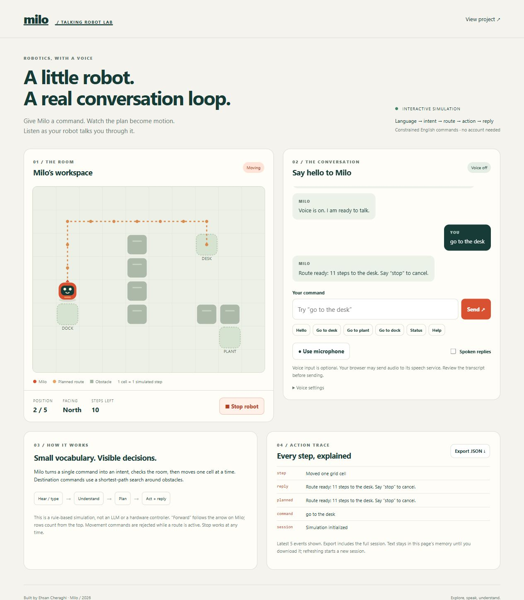

# Milo — Talking Robot Lab

A talking robot you can inspect: type or speak a supported English command, watch an obstacle-aware route unfold, and hear a reply.

**[Open the live lab](https://ehsan-ch.github.io/talking-robot-lab/)** · [Tests](https://github.com/Ehsan-Ch/talking-robot-lab/actions)



## What the project demonstrates

- A complete input → intent → planning → simulated action → spoken response loop.
- A deterministic command grammar with explicit rejections instead of invented actions.
- Shortest-path navigation on a 10 × 8 grid using breadth-first search.
- Stepwise execution, cancellation, busy-state protection and a timestamped JSON audit.
- Optional browser speech recognition, transcript review, speech synthesis and a fully functional typed fallback.
- No dependencies, API keys, accounts, build pipeline or application backend.

This is a **rule-based browser simulation**, not an LLM, a trained speech model, a physics simulator or a physical robot controller. The browser supplies speech services. English recognition accuracy depends on that service, the microphone and the speaker; this project does not measure it.

## Run locally

Install Node.js 22 or later. From the project folder:

```sh
npm test
npm start
```

Open http://127.0.0.1:8795/. No `npm install` is necessary. Use a local HTTP server or HTTPS hosting; do not open the HTML directly as a file because the app uses JavaScript modules. Set `PORT` to change the preview port. The bundled server binds only to localhost and is for development.

## Try these commands

| Command | Result |
|---|---|
| `hello`, `who are you`, `help` | Conversation and supported vocabulary |
| `go to the desk`, `go to plant`, `go to dock` | Plan a shortest route around obstacles |
| `move forward two steps`, `back 1` | Move 1–5 cells relative to the robot’s arrow |
| `turn left`, `turn right` | Rotate 90 degrees |
| `status`, `where are you` | Read the current pose and remaining steps |
| `stop`, `cancel` | Clear the active route immediately |

Commands are case-insensitive and accept trailing sentence punctuation and an initial “please”. One command per message: compound, negated or unsupported commands are rejected. Named destination navigation updates heading along the path; relative backward motion keeps its heading. A relative move is checked in full before execution, so a blocked request never executes partially. New movement commands are rejected while moving; stop first. Hiding the tab cancels the route and microphone/speech activity; it does not automatically resume later.

## Voice and privacy

Typed commands work without microphone permission. Click **Use microphone** only if you want speech input. The browser may send audio to its recognition provider; this is not guaranteed to be offline. Recognized words fill the input for review, and **Send** executes the command. The app does not upload the transcript to an application server or store recordings. Speech synthesis voice availability and processing depend on the browser/OS. Spoken replies default to off. Browser support varies; unsupported voice input is visibly disabled. Recognition errors fall back to typing.

The transcript and action audit exist only in page memory, unless you explicitly export JSON. Refreshing clears the session. The UI never inserts user-supplied text as HTML. External requests from hosting and browser speech services are separate from the app’s in-memory storage.

## Architecture and evidence

- `core.mjs`: intent parsing, room constraints, BFS, robot state machine and audit.
- `speech.mjs`: injected speech adapters, cancellation and stale callback protection.
- `app.mjs`: DOM, SVG map, conversation, microphone review and export.
- `tests/`: functional tests including exhaustive reachable cell pairs and speech lifecycle mocks.
- `docs/DESIGN.md`: behavior contract, reproducible scenarios and limitations.
- `docs/VERIFICATION.md`: release and observed browser checks (added at publication).

GitHub Actions runs the tests on Node 22 and 24. These tests validate application behavior; mocked voice tests do not establish real recognition accuracy or audible voice quality.

## References

- [MDN: SpeechRecognition](https://developer.mozilla.org/en-US/docs/Web/API/SpeechRecognition) — browser support and recognition service behavior.
- [MDN: speechSynthesis](https://developer.mozilla.org/en-US/docs/Web/API/Window/speechSynthesis) — browser-provided speech output.

MIT license. Built by Ehsan Cheraghi.
